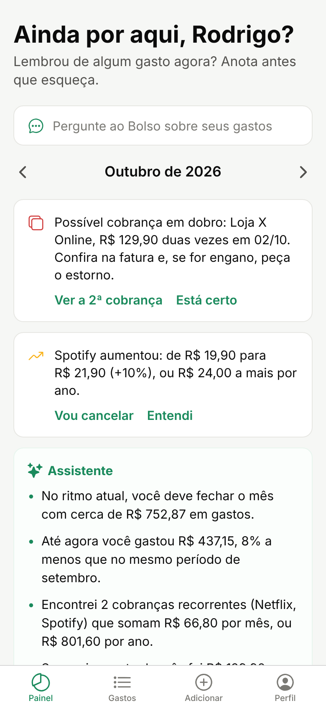
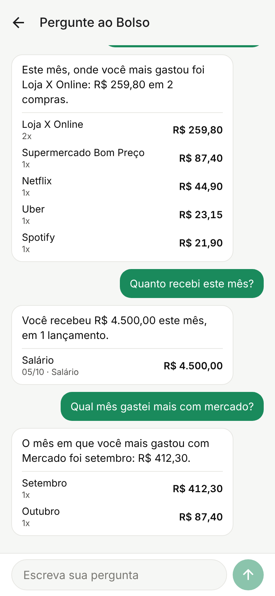
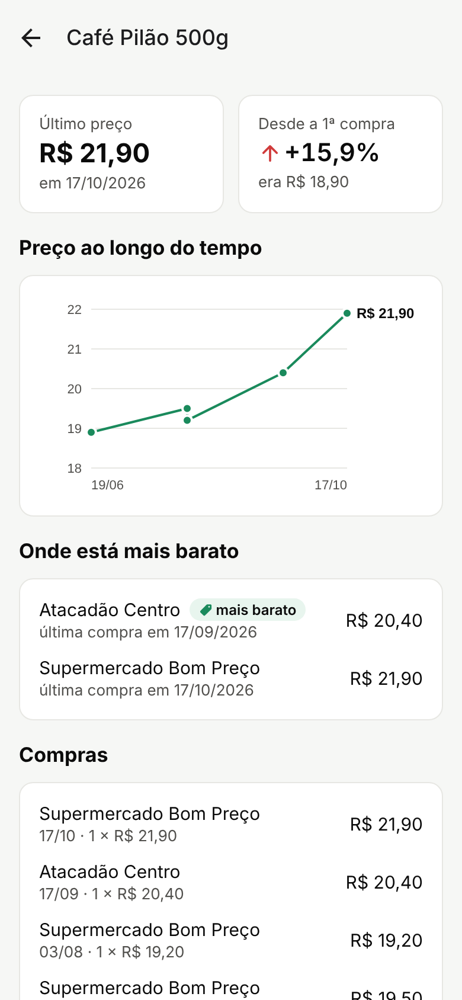
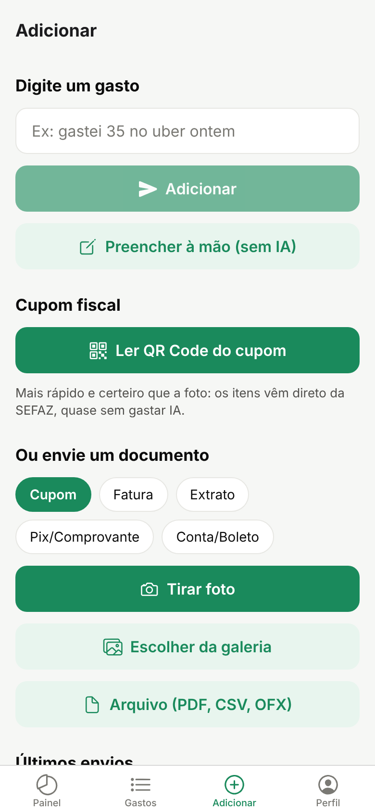

<div align="center">



<br />

<a href="https://www.linkedin.com/in/rodrigo-caetano-391648239/"></a>
<a href="mailto:caetanorodrigo46@gmail.com"></a>
<a href="https://github.com/krypt0wl/bolso"></a>

</div>

## 🦉 Sobre mim

```js
const krypt0wl = {
  papel: "Desenvolvedor full stack",
  stack: ["Node.js", "Express", "Prisma", "React Native", "Expo"],
  gostoDe: "IA que resolve problema de verdade, e custa pouco",
  construindoAgora: "Bolso, um controle de gastos que lê cupom, fatura e extrato com IA",
  horarioFavorito: "madrugada 🌙",
};
```

- 🔭 Construo apps **web e mobile de ponta a ponta**: API, banco de dados, app no celular e deploy.
- 🧠 Uso **IA como ferramenta de produto**: saída validada por schema, custo medido por chamada e código fazendo as contas.
- 🌱 Sempre estudando e transformando o que aprendo em projetos de verdade.

## ⭐ Em destaque: Bolso

<table>
  <tr>
    <td width="58%" valign="top">

**Controle de gastos pessoais em que a IA faz o trabalho chato.** Tire foto do cupom, aponte a câmera para o QR Code da nota, envie a fatura em PDF ou o extrato do banco, ou só digite *"gastei 35 no uber ontem"*. O Bolso lê, categoriza e monta o painel do mês.

- 🧾 Lê **cupom, fatura, extrato (CSV/OFX), Pix e boletos** com a API do Claude
- 📷 **QR Code da NFC-e**: itens direto da SEFAZ, quase sem gastar IA
- 💬 **Pergunte ao Bolso**: *"quanto gastei com Uber desde agosto?"*
- 🔔 Alertas de **cobrança em dobro** e de **assinatura que aumentou**
- 📈 **Inflação pessoal** e o mercado mais barato para cada produto
- 🔁 Mesmo gasto no cupom e na fatura conta **uma vez só**
- 💸 Cada chamada à IA tem o **custo registrado** e aparece no app

<br />


<br /><br />

👉 **[Ver o repositório](https://github.com/krypt0wl/bolso)**

  </td>
    <td width="42%" align="center" valign="top">
      
      
      
      
    </td>
  </tr>
</table>

## 🛠️ Tecnologias

**Linguagens**<br />


**Back-end e dados**<br />


**Front-end e mobile**<br />


**IA, nuvem e ferramentas**<br />


## 📊 GitHub em números

<div align="center">

<picture>
  <source media="(prefers-color-scheme: dark)" srcset="https://github-readme-stats.vercel.app/api?username=krypt0wl&show_icons=true&locale=pt-br&include_all_commits=true&bg_color=0D1220&title_color=34D399&icon_color=22D3EE&text_color=E2E8F0&border_color=1F2A3A" />
  
</picture>
<picture>
  <source media="(prefers-color-scheme: dark)" srcset="https://github-readme-stats.vercel.app/api/top-langs/?username=krypt0wl&layout=compact&langs_count=6&locale=pt-br&bg_color=0D1220&title_color=34D399&text_color=E2E8F0&border_color=1F2A3A" />
  
</picture>

</div>

## 🤝 Vamos criar algo juntos?

Tem uma ideia, uma vaga ou um projeto em que eu posso ajudar? Me chama no **[LinkedIn](https://www.linkedin.com/in/rodrigo-caetano-391648239/)** ou por **[e-mail](mailto:caetanorodrigo46@gmail.com)**.

<div align="center">
<br />
<sub>🦉 Enquanto o mundo dorme, o código compila.</sub>
</div>
